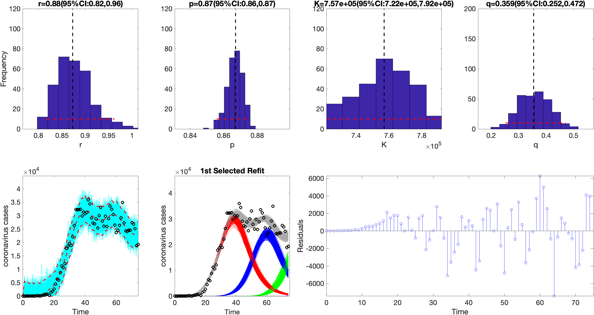
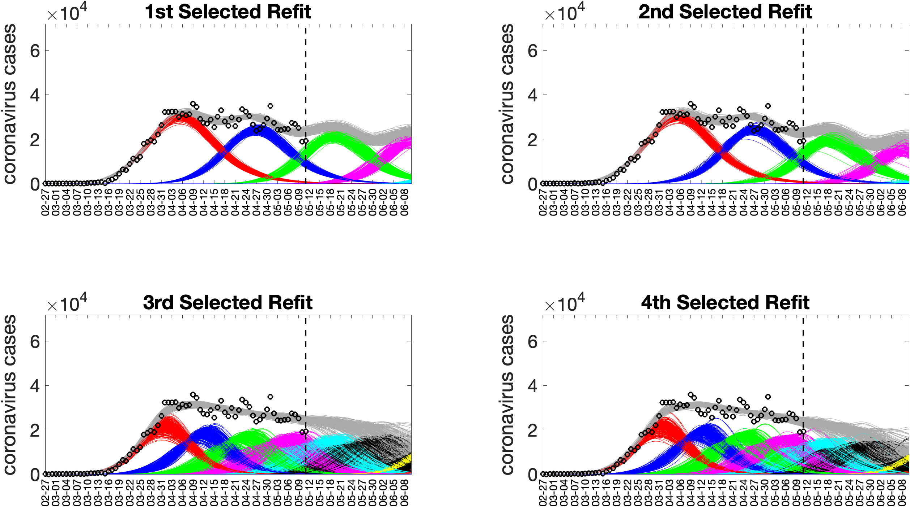
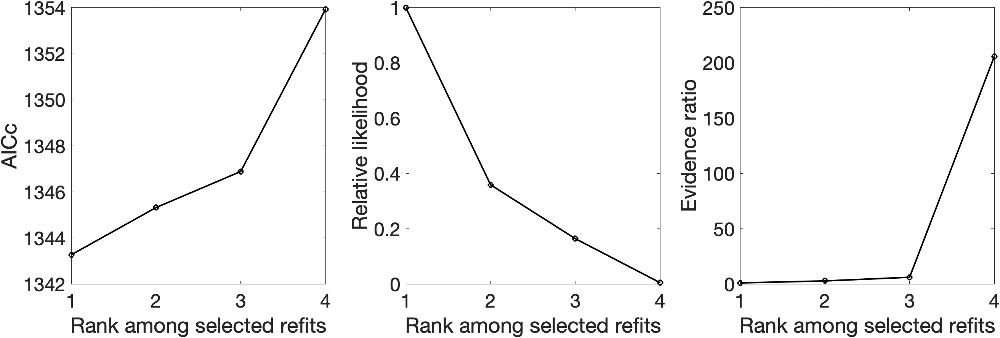
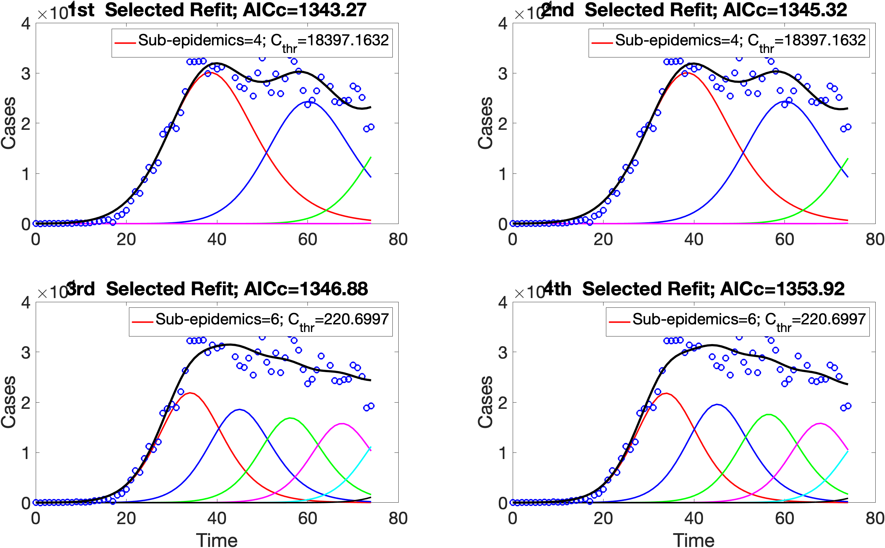
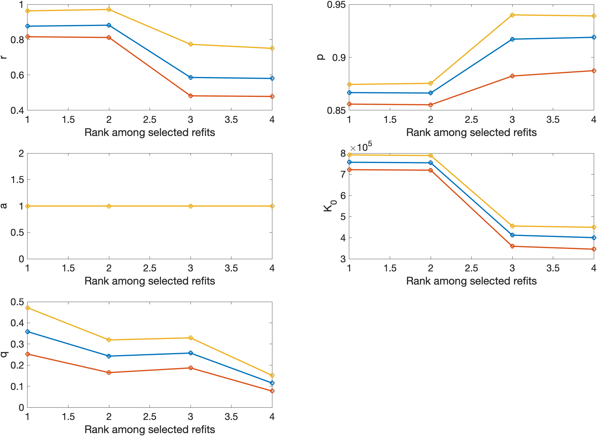
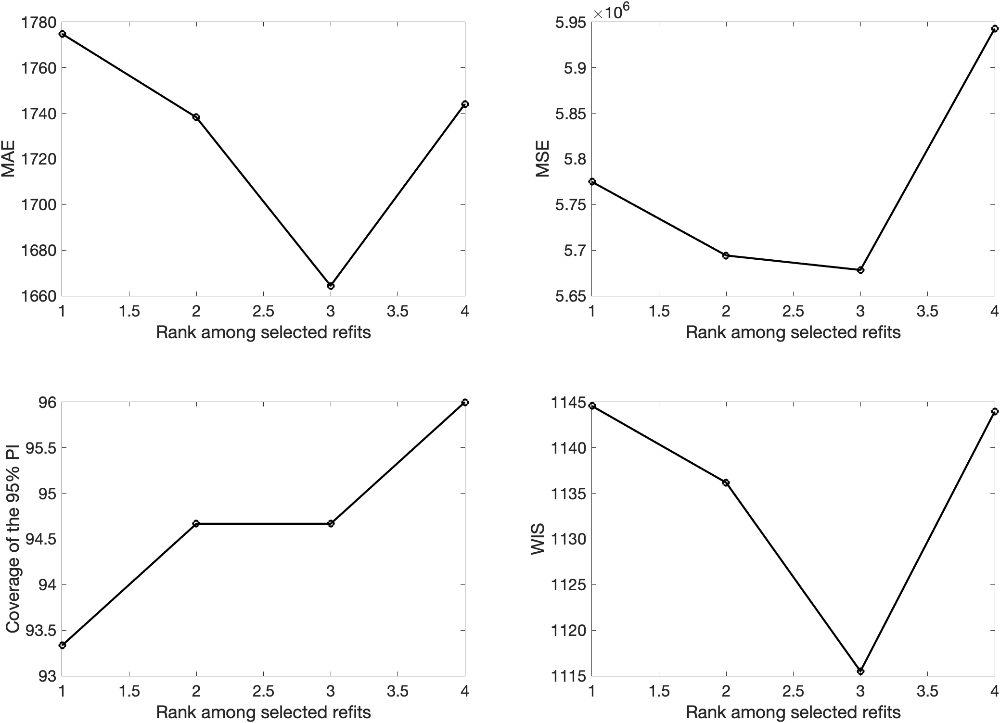
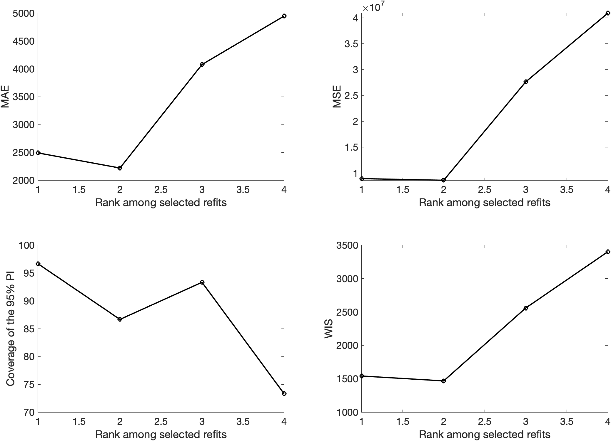
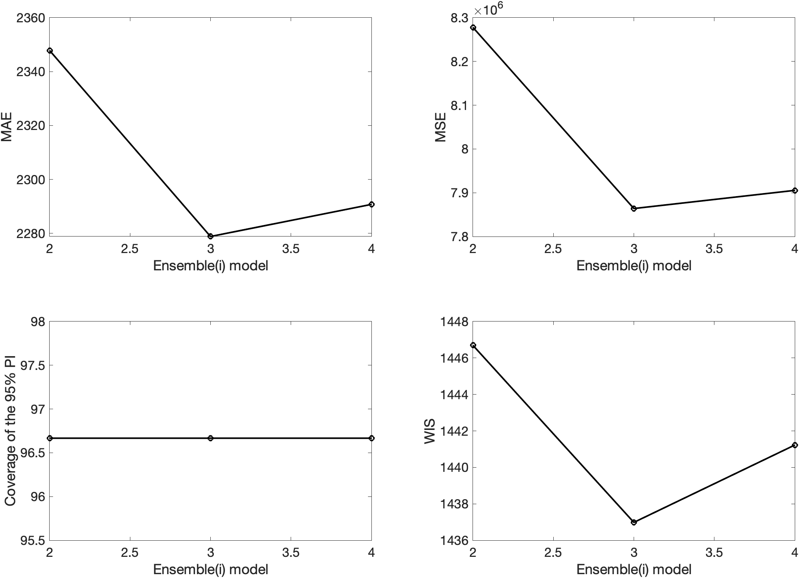

# SpatialWavePredict Toolbox

**Fit epidemic curves, compare sub-epidemic models, and generate short-term ensemble forecasts in MATLAB.**

SpatialWavePredict represents an epidemic wave as the aggregate of overlapping sub-epidemics. This structure can describe trajectories that are difficult to capture with a single growth curve, including multiple peaks, prolonged plateaus, and damped oscillations. The toolbox combines parameter estimation, model ranking, parametric bootstrap uncertainty, forecast visualization, and performance evaluation, and adds tools to check its own forecasts: rolling-origin evaluation against a baseline, a parameter identifiability report, and the effective reproduction number.

[Quick start](#quick-start) · [Input data](#input-data) · [Configuration](#configuration) · [Evaluating forecasts](#evaluating-forecasts-over-many-dates) · [Identifiability](#parameter-identifiability) · [Reproduction number](#effective-reproduction-number) · [Outputs](#outputs) · [Limitations](#interpretation-and-current-limitations) · [Citation](#citation)

> **Research software:** validate the numerical results and uncertainty estimates for your dataset and configuration. The [current limitations](#interpretation-and-current-limitations) apply to the implementation, not just to the interpretation of its plots.

## Overview

The workflow fits candidate models, selects and refits top candidates, ranks the accepted refits using the corrected Akaike information criterion (AICc), and generates individual-model and ensemble forecasts. Available components include generalized-logistic and Richards-type growth functions, exponential or power-law decline in successive sub-epidemic sizes, alternative estimation objectives and observation-error distributions, and bootstrap-based summaries.

| Task | Entry point |
| --- | --- |
| Fit and rank models for one date | `Run_SW_subepidemicFramework` |
| Inspect rankings and fits | `plotRankings_SW_subepidemicFramework`, `plotFit_SW_subepidemicFramework` |
| Forecast and score one date | `plotForecast_SW_subepidemicFramework` |
| Forecast from many dates and compare with a baseline | `spatialWaveRollingForecast` |
| Effective reproduction number of the fitted models | `plotReproductionNumber_SW` |
| Check the installation | `tests/spatialWaveSelfCheck` |
| Save the example figures of this README | `make_readme_figures` |

**What “spatial wave” means:** sub-epidemics are latent components of an aggregate trajectory. They are not automatically identified geographic locations, transmission chains, or measured subpopulations. A data matrix may contain several regions, but the standard workflow fits one selected column at a time; it does not jointly estimate a spatial transmission network.

For the methodology and illustrated applications, see the [2024 tutorial][tutorial] and the [original framework paper][framework]. Published comparisons apply to the datasets, methods, and forecast horizons evaluated in those studies; they do not establish universal forecasting superiority.

### Default model and parameters

For the generalized-logistic building block (`flag1=1`) with exponential decline in successive sub-epidemic sizes (`typedecline2=[1]`), the cumulative size of an **active** sub-epidemic follows

```math
\frac{dC_j(t)}{dt} = rC_j(t)^p\left(1-\frac{C_j(t)}{K_j}\right), \qquad K_j = K_0 e^{-q(j-1)}.
```

| Symbol | Interpretation |
| --- | --- |
| $C_j(t)$ | Cumulative size of sub-epidemic $j$ at time $t$. |
| $r$ | Growth-rate coefficient shared across sub-epidemics. |
| $p$ | Early-growth scaling exponent; $p=1$ gives approximately exponential early growth when $C_j(t)\ll K_j$. |
| $K_0$ | Carrying capacity of the first sub-epidemic. |
| $q$ | Decline parameter across successive sub-epidemics: $q=0$ gives equal carrying capacities, while $q>0$ gives progressively smaller capacities. Later sub-epidemics are never larger than earlier ones. |

With the power-law family (`typedecline2=[2]`) the sizes are $K_j = K_0\, j^{-q}$.

With threshold-triggered onset (`onset_fixed=0`), each subsequent component activates when the preceding component reaches the onset threshold, $C_{\mathrm{thr}}$ (`onset_thr` in the model function). Inactive components do not grow. Activation times are located by the ODE solver's event detection ([`simulateSpatialWave.m`][simulator]), so results do not depend on the spacing of the observation times. See [the implemented model equations][ode] for the activation rule and alternative growth functions.

## Requirements and installation

The fitting and bootstrap workflow uses MATLAB and the following products:

| Product | Functions used by the toolbox |
| --- | --- |
| Optimization Toolbox | `fmincon`, `optimoptions` |
| Global Optimization Toolbox | `MultiStart`, `createOptimProblem`, `CustomStartPointSet` |
| Statistics and Machine Learning Toolbox | `quantile` and random sampling functions such as `normrnd`, `poissrnd`, `nbinrnd`, and `datasample` |
| Parallel Computing Toolbox (optional) | Parallel candidate search and bootstrap refits, when `useParallel` is switched on |

See the MathWorks documentation for [constrained optimization][fmincon-doc], [MultiStart][multistart-doc], and [normal random sampling][normrnd-doc]. A tested minimum MATLAB release is not documented; record your environment using `ver`. GNU Octave is not supported: it lacks `MultiStart`, and its ODE solver locates activation events less precisely.

Download the repository using **Code → Download ZIP**, or clone it:

```bash
git clone https://github.com/gchowell/SpatialWavePredict-Toolbox.git
```

Open the repository root in MATLAB, then run:

```matlab
cd('spatialWave_subepidemicFramework code');
addpath(pwd);

if ~exist('input', 'dir'), mkdir('input'); end
if ~exist('output', 'dir'), mkdir('output'); end

ver
which options -all
which plotForecast_SW_subepidemicFramework -all
```

**Keep MATLAB's current folder set to `spatialWave_subepidemicFramework code`.** The functions use relative `./input/` and `./output/` paths. The repository also contains a root-level copy of `plotForecast_SW_subepidemicFramework.m`; use the implementation inside the code directory. Avoid adding multiple versions of this project recursively to the MATLAB path.

**Using this toolbox next to SubEpiPredict.** Both toolboxes have an `options.m` and an `options_forecast.m`. MATLAB uses the copy in the current folder first, which is another reason to stay in the code directory. The files that are specific to this toolbox carry `_sw`, `_SW` or `spatialWave` in their names (`options_fit_settings_sw.m`, `options_Rt_sw.m`, `plotReproductionNumber_SW.m`) so that they cannot be mistaken for the SubEpiPredict files of the same purpose.

### Check the installation

```matlab
addpath(pwd); cd tests; spatialWaveSelfCheck(); cd ..
```

The self-check takes about a minute and ends with a line such as `spatialWaveSelfCheck: 45 checks passed.` It compares the simulator with closed-form solutions, checks the objectives, the baseline, the identifiability report and the reproduction number against numbers worked out by hand or by an independent reference implementation, and runs one small fit with `MultiStart`. The unit tests in `tests/` can be run with `runtests('tests')`.

## Quick start

This historical example uses the bundled U.S. COVID-19 data and the configuration shown below. It is not a live data feed or a guarantee of exact reproduction of published numerical results.

### 1. Configure the example

Open the two configuration functions:

```matlab
edit options
edit options_forecast
```

In **`options.m`**, replace the corresponding assignments with these values. Retain the existing function declaration, global declarations, and other configuration logic; do not replace the whole file with this excerpt.

```matlab
% Data and dates
cumulative1 = 1;
outbreakx = 52;                 % U.S. aggregate in this example matrix
caddate1 = '05-11-2020';         % Calibration snapshot / forecast origin
cadregion = 'USA';
caddisease = 'coronavirus';
datatype = 'cases';
DT = 1;                        % Daily observations
datevecfirst1 = [2020, 2, 27];
datevecend1 = [2021, 5, 31];     % Later snapshot used for verification

% Fitting and uncertainty
smoothfactor1 = 7;
calibrationperiod1 = 90;
method1 = 0;                   % Least squares
dist1 = 0;                     % Normal observation-error draws
numstartpoints = 20;
B = 300;

% Candidate models
npatches_fixed = 3;
topmodelsx = 4;
flag1 = 1;                     % Generalized-logistic building block
onset_fixed = 0;
typedecline2 = [1];             % Exponential decline
```

In **`options_forecast.m`**, use:

```matlab
getperformance = 1;            % Evaluate against later observations
deletetempfiles = 0;
forecastingperiod = 30;         % 30 observation intervals: here, 30 days
weight_type1 = 1;              % Akaike relative-likelihood weights
```

These settings use two different files already included in `input/`:

```text
cumulative-daily-coronavirus-cases-USA-05-11-2020.txt
cumulative-daily-coronavirus-cases-USA-05-31-2021.txt
```

The first supplies calibration data; the second supplies later observations for forecast evaluation. Keep the fitting settings unchanged between fitting, plotting, and forecasting. Assigning a value only in MATLAB's Command Window is not a substitute for editing the configuration functions, which are called again by the workflow.

For an installation check, `B` can be temporarily reduced, for example to `20`. Such a run checks setup only: it is not sufficient evidence of stable tail quantiles, optimizer convergence, or interval coverage. Restore and assess the computational settings before substantive analysis. The [smoothing caveat](#interpretation-and-current-limitations) also applies to this default-style example.

### 2. Fit, inspect, and forecast

Run these commands from the code directory:

```matlab
Run_SW_subepidemicFramework(52, '05-11-2020');

plotRankings_SW_subepidemicFramework(52, '05-11-2020');
plotFit_SW_subepidemicFramework(52, '05-11-2020');

plotForecast_SW_subepidemicFramework(52, '05-11-2020', 30, 1);
```

The forecast arguments are the selected data column, calibration date, horizon in observation intervals, and ensemble-weighting option. Other settings are read from the configuration functions. The four entry points can also be called without arguments to use their configured defaults.

With `B = 300` and `numstartpoints = 20` the fit of this example took roughly 45 minutes in serial on the machine it was last checked on; a parallel pool (`useParallel`, below) shortens it considerably. Your times will differ. The fit driver and the forecast script reset the random number generator themselves (setting `rngSeed`, default `1`), so repeating a command on the same files gives the same numbers. A call to `rng` before them has no effect unless `rngSeed` is set to empty.

After the bootstrap of each ranked model the fit prints a [parameter identifiability table](#parameter-identifiability). The forecast prints the scores of every ranked model and ensemble next to those of a [flat baseline](#evaluating-forecasts-over-many-dates).

### 3. Inspect the results

Look in `output/` for the fit MAT files, parameter summaries, forecast CSVs and performance tables listed under [Outputs](#outputs). The figures below show what the plotting functions display for this example.

<p align="center">
  
</p>

*Top-ranked model of the quick-start example (`plotFit_SW_subepidemicFramework`): bootstrap distributions of the parameters (horizontal red dashed line: 95% interval; vertical black dashed line: the fitted value), the fit to the calibration data with its bootstrap curves, the sub-epidemics that make up the wave, and the residuals. The envelope around the fit is a bootstrap simulation envelope, not a Bayesian credible interval.*

<p align="center">
  
</p>

*Forecasts of the ranked models (`plotForecast_SW_subepidemicFramework`), with 95% prediction intervals and, because `getperformance = 1`, the observations that came later. The intervals take the model as right; see [limitations](#interpretation-and-current-limitations).*

**Run the fitting step with your current code before plotting.** Current plotting and forecasting functions require a matching `FinalFit-original-*.mat` manifest and its associated rank files. Older bundled results may not contain this information; an old `ABC-original-*.mat` search result is not a replacement. See the [ranking loader][ranking-loader]. Archive earlier output before rerunning an analysis, because files can be overwritten.

## Input data

### Matrix layout

Place a plain numeric, whitespace-delimited `.txt` file in `input/`. Rows represent successive observation intervals; columns represent distinct regions or groups. Do not include a header, dates, region names, or a separate time-index column. Select one column using the one-based integer `outbreakx`.

For example, this illustrates the layout of two incidence series, not a complete fitting example:

```text
12  4
18  7
27  9
35  14
43  20
```

### Filenames and dates

The [runner][runner] constructs the input filename from the options:

```text
Incidence:  <frequency>-<disease>-<datatype>-<region>-<mm-dd-yyyy>.txt
Cumulative: cumulative-<frequency>-<disease>-<datatype>-<region>-<mm-dd-yyyy>.txt
```

`<frequency>` is `daily` for `DT=1`, `weekly` for `DT=7`, or `yearly` for `DT=365`. The remaining fields correspond to `caddisease`, `datatype`, `cadregion`, and `caddate1`. Use two-digit months/days and a four-digit year consistently. Set `datevecfirst1` to the date represented by the first row.

**A filename date does not truncate the matrix.** The calibration file must actually end at the intended forecast origin. For retrospective evaluation, provide a separate later snapshot identified by `datevecend1`, with the same start date, column ordering, and observation frequency. That file must cover the full forecast horizon; it is read by [the verification-data loader][data-loader]. The [rolling forecast](#evaluating-forecasts-over-many-dates) writes the calibration files of earlier dates for you, from the first rows of the later snapshot.

### Data preparation

Use regularly spaced, finite, nonnegative observations. Resolve missing intervals, reporting corrections, and changes in definitions before fitting, and document the handling rather than silently replacing missing values with zeros. Count-likelihood analyses require integer incidence observations.

Set `cumulative1=0` for incidence or `cumulative1=1` for cumulative counts. Cumulative input is converted as `[y(1); diff(y)]`, so the first cumulative value is treated as the first interval's incidence. Account for any pre-existing cumulative baseline when preparing a truncated series; cumulative decreases create negative incidence and require reconciliation.

The runner retains the most recent calibration window and removes leading zeros within that window. Check the resulting start date and usable sample size. All-zero inputs are not supported by the current preprocessing path. For AICc, the actual number of fitted observations must exceed the number of estimated parameters by more than one; eight observations alone do not guarantee an adequate dataset.

## Configuration

Three configuration functions are read by the workflow, and a fourth is optional:

| File | Purpose |
| --- | --- |
| `options.m` | Data, calibration, estimation method, candidate models. |
| `options_forecast.m` | Forecast horizon, scoring, ensemble weights. |
| `options_Rt_sw.m` | Generation interval for the reproduction number. |
| `options_fit_settings_sw.m` (optional) | Advanced settings of the fit, the reports and the scores. |

### Fitting and model selection: `options.m`

| Setting | Meaning |
| --- | --- |
| `calibrationperiod1` | Maximum number of recent observations used for fitting, before leading-zero removal. |
| `smoothfactor1` | Moving-mean span in observations; `1` disables smoothing. |
| `numstartpoints` | Number of start points of each candidate fit. |
| `B` | Requested number of parametric bootstrap realizations per selected model. |
| `npatches_fixed` | Maximum candidate sub-epidemic count during fitting. A forecast may start further sub-epidemics after the calibration period (see below). |
| `topmodelsx` | Requested number of selected models to refit; limited by available candidates. A one-component setting forces this to one. |
| `flag1` | Growth-function selector; `1` is generalized logistic, `2` is a generalized Richards-type variant, and `4` is Richards. |
| `onset_fixed` | `0`: threshold-triggered onset; `1`: simultaneous onset at time zero. See the implementation cautions. |
| `typedecline2` | `[1]`: exponential size decline; `[2]`: power-law decline; `[1 2]`: search both families. |

The implementation also includes generalized-growth (`flag1=0`), classical-logistic (`flag1=3`) and Gompertz (`flag1=5`) branches. The “Linear Model” comment for `flag1=3` in `options.m` does not match the implemented logistic equation. Consult [the model equations][ode] when using additional branches rather than relying on abbreviated labels.

**Sub-epidemics in the forecast.** The ranking counts the sub-epidemics that are active within the calibration period. During the forecast a model may start up to 10 further sub-epidemics, sized by the same decline rule, once the calibration period has ended. If a further sub-epidemic starts on the first forecast day in many bootstrap curves, the fit was limited by `npatches_fixed`, and the forecast script gives the warning `SpatialWave:PatchLimitBinding`. Refit with a larger `npatches_fixed` and compare.

### Estimation objective versus observation error

`method1` selects the fitting objective; `dist1` selects the observation-error distribution used in uncertainty calculations. They are distinct settings and must be consistent with the analysis. For the likelihood methods (`method1` of 1, 3, 4 or 5) the error distribution follows the method, whatever `dist1` says, and the file names record the distribution actually used.

| `method1` | Objective |
| --- | --- |
| `0` | Least squares |
| `1` | Poisson maximum likelihood |
| `2` | Pearson chi-squared objective |
| `3` | Negative-binomial likelihood: variance = mean + alpha × mean |
| `4` | Negative-binomial likelihood: variance = mean + alpha × mean² |
| `5` | Negative-binomial likelihood: variance = mean + alpha × mean^d |
| `6` | Sum of absolute deviations / Laplace branch; see limitations before use |

For `dist1`, `0` denotes normal errors, `1` Poisson errors, `2` a variance-to-mean negative-binomial formulation, `3`–`5` the corresponding negative-binomial formulations above, and `6` Laplace errors. With `method1` of `0` or `2`, `dist1` must be `0`, `1` or `2`. Listing an option does not imply that every combination has been validated. Count likelihoods are evaluated on the reported counts, not on a moving average of them.

### Forecasting and ensembles: `options_forecast.m`

`forecastingperiod` counts **observations**, not always days: a value of `4` means four days for daily data or four weeks for weekly data. `getperformance=1` enables evaluation using the later snapshot. `deletetempfiles=0` retains intermediate forecast files.

| `weight_type1` | Ensemble weights |
| --- | --- |
| `-1` | Equal weights |
| `1` | Akaike relative-likelihood weights; the default |
| `0` | Legacy inverse-AICc weights; requires positive AICc and is not standard Akaike weighting |
| `2` | Inverse weighted interval score (WIS) weights calculated on calibration data; based on in-sample fit, not held-out forecasts |

<p align="center">
  
</p>

*Ensemble forecasts of the quick-start example. The shaded envelopes are observation prediction intervals, not Bayesian credible bands.*

The [AICc-weight helper][weights] uses the final selected-refit scores. With more than one selected model, the driver constructs ensembles of the top two, top three, and so on, up to the available requested count. When one model's AICc is several units below the others, Akaike weights put almost all weight on it and the ensembles coincide with that model. A prior-forecast-WIS branch exists in the code, but the driver does not provide a complete rolling-origin weighting workflow; do not interpret that branch as validated historical-performance weighting.

### Advanced settings: `options_fit_settings_sw.m`

This file is optional. Copy `options_fit_settings_sw_example.m` to `options_fit_settings_sw.m` and uncomment the lines you need; every setting you do not mention keeps its default. A misspelled setting name is an error, so it cannot be ignored silently. [`spatialWaveFitSettings.m`][settings] documents every setting.

| Setting | Default | Effect |
| --- | --- | --- |
| `useParallel` | `false` | Run the local solves of the candidate search and the bootstrap refits in a parallel pool. |
| `rngSeed` | `1` | Seed applied by the fit driver and the forecast script; empty leaves the generator as it is. |
| `thresholdLowPoints` | `6` | Onset thresholds added below the first step of the regular grid, so that waves whose sub-epidemics start early are among the candidates. `0`: the regular grid alone. |
| `rLB`, `rUB`, …, `qLB`, `qUB` | `[]` | Replace a search bound. A lower bound equal to its upper bound fixes the parameter. |
| `weekdayAdjustment` | `false` | Day-of-week factors for daily data (below). |
| `baselineWindow` | `[]` | Observations the flat baseline averages: 7 for daily data, 1 otherwise. |
| `notIdentifiedRatio`, `weaklyIdentifiedPII`, `tradeoffCorrelation`, `PIIscale` | `0.5`, `1`, `0.9`, `[]` | Thresholds of the identifiability report. |
| `modelErrorIntervals` | `false` | In a rolling forecast, also score intervals widened by earlier forecast errors. |

Settings that change what a fit computes are saved with the fit. The rolling forecast compares them before it uses a saved fit again. Settings of reports and scores (the last three rows and `baselineWindow`) never make a saved fit out of date.

**Day-of-week adjustment.** With `weekdayAdjustment = true`, seven factors are estimated from the calibration data before the fit (each observation divided by the mean of the seven days centred on it; the factor of a weekday is the median of its ratios). The model curve is multiplied by them in the fit, the bootstrap and the forecast; the data are not changed. It requires daily data, `smoothfactor1 = 1`, and at least 21 calibration days. The factors are not counted as parameters, so the AICc of a fit with the adjustment must not be compared with that of a fit without it. Because the residuals become smaller, least-squares prediction intervals become narrower.

## Evaluating forecasts over many dates

One forecast from one date says little about a method. `spatialWaveRollingForecast` repeats the fit and the scored forecast from a list of dates and summarizes the scores by horizon, next to a baseline that uses no model.

```matlab
dates = cellstr(datestr(datenum(2020,4,27):14:datenum(2020,7,6), 'mm-dd-yyyy'));
R = spatialWaveRollingForecast(dates, [], [], [], 'quiet', true);
```

- **Data.** The data of every date come from the file of the most recent date (`datevecend1`). A date without its own file in `input/` gets one, written from the first rows of that file. These are the counts as known today, not as known on that date.
- **Saved fits are used again.** A date whose fit is in `output/`, made with the same `B`, `numstartpoints`, `topmodelsx` and fit settings, is not fitted again, so an interrupted run continues with the same command. Before a date is fitted again, its earlier fit files are copied to `output/replaced-by-rolling/`. A saved fit is recognized by its settings, not by its data: after correcting data, give `'refit', true`.
- **`'quiet', true`** sends the text of each fit and forecast to a log file per date.
- `getperformance` must be `1`.

**The baseline** repeats the mean of the last observations (7 for daily data). Its prediction intervals come from the errors the same rule made earlier in the calibration data. It is scored by the functions that score the models. A model is worth using at a horizon when its WIS there is below the baseline's.

**What is reported.** Scores “over h” are averages over the first h observations of a forecast; scores “at step h” are those of observation h alone. For the WIS, three comparisons with the baseline are printed; values below 1 favour the model.

| Comparison | Meaning |
| --- | --- |
| Ratio of means | Mean WIS of the model divided by the mean WIS of the baseline. Dates with large counts weigh more. |
| Typical ratio | Geometric mean over the dates of the ratio. Every date weighs the same. |
| Share better | Share of dates on which the model's WIS is below the baseline's. |

A date-by-date table follows, because averages can hide that a model does well on some dates and badly on others. Model codes in the tables: `0` is the baseline, `k` is ranked model k, `100+k` is Ensemble(k).

Forecasts from nearby dates overlap and are not independent. With fewer than 10 dates the function says so. If all dates fall on the same weekday, single-step scores mix the horizon with the day of the week.

### Intervals that allow for model error (optional)

The prediction intervals come from the bootstrap refits and the error structure, and both take the model as right. With `modelErrorIntervals = true` the rolling forecast also reports intervals widened by each model's own earlier forecast errors: for a forecast from date D at step h, the errors of earlier forecasts of the same model near step h, measured against their own 95% intervals, give a widening factor (their 95% quantile, never below 1). Only observations already known on date D are used.

The median forecast is not moved, so MAE is unchanged; coverage and WIS change. A step with fewer than 10 earlier errors is scored as forecast, so the first dates of a run are not affected, and the method responds to a failure only after it has been observed. Switching the setting on or off repeats no fit.

## Parameter identifiability

After the bootstrap of each ranked model, and again in `plotFit_SW_subepidemicFramework` and `plotForecast_SW_subepidemicFramework`, the toolbox reports how well the data determine each parameter. It follows the identifiability report of the SubEpiPredict toolbox.

| Column | Meaning |
| --- | --- |
| estimate, CI LB, CI UB | The ranked fit and the 95% bootstrap interval. |
| PII | log10(CI UB / CI LB): the width of the interval in decades; 1 is a factor of 10. Undefined when CI LB is 0 or below. |
| range | Share of the search range the interval covers. |
| scale | Headline measure: the PII where the lower search bound is positive (r, K, alpha, d), the range share where it is 0 (p, q, a). |
| ratio | PII divided by the largest PII the bounds allow, or the range share. Near 1, the interval is the search range. |
| atLB, atUB | Share of refits at each bound. |
| MCSE | Monte Carlo error of the PII; smaller differences between two PII values are noise. |
| verdict | `identified`, `weakly identified`, `at a bound`, `not identified`, or `fixed`. |

Below the table the report lists **pairs of parameters that trade off** against each other: those whose rank correlation over the refits is 0.9 or more in size. In this model `r` with `p`, and `K` with `q`, can make up for each other, so each may have a wide interval although a combination of them is well determined. Read the verdicts together with this line: a parameter can be labelled identified on its own while it is not determined separately from its partner.

The forecast script writes `identifiability-*.csv` for all ranked models. The report is computed from the refits and search bounds saved with a fit, so changing its thresholds repeats no fit.

“Identified” is relative to the search bounds and to the bootstrap, which resamples around the fitted curve. It does not say that the model is right: a model can be tightly identified and forecast badly.

## Effective reproduction number

```matlab
edit options_Rt_sw      % set the generation interval for your pathogen
summary = plotReproductionNumber_SW([], '05-11-2020', 30);
```

`plotReproductionNumber_SW` reads a saved fit and computes, for every ranked model, the effective reproduction number over the calibration period and the forecast, with a 95% interval from the bootstrap refits. No fit is repeated.

- **Method.** The renewal equation, R(t) = I(t) / Σ I(t−s) w(s), where w is the generation-interval distribution (gamma, exponential, or a fixed interval).
- **From the model curve, not the data,** and without the day-of-week factors if the fit used them: a reporting cycle is not a transmission cycle.
- **Early values are blank** until the curve covers 99% of the generation interval. Before that, the equation misses infectors from before the first observation and overstates R.
- **Set the generation interval.** `options_Rt_sw.m` ships with placeholder values, in the time unit of the data (days for daily data, weeks for weekly data). The values of R depend directly on them; only whether R is above or below 1 does not.

<p align="center">
  
</p>

*Effective reproduction number of the ranked models: median over the bootstrap refits (solid red), 95% interval (dashed red) and the ranked fit (black); the vertical dashed line marks the end of the calibration period. The values depend on the generation interval in `options_Rt_sw.m`.*

R inherits the limits of the fit. Its interval reflects parameter uncertainty given the model, and beyond the calibration period it is only as good as the forecast. Because each new sub-epidemic bends the curve upward, R can rise above 1 repeatedly within one wave.

## Outputs

Results are written to `output/`. Exact filenames encode many, but not all, analysis settings.

| File or pattern | Contents |
| --- | --- |
| `ABC-original-*.mat` | Candidate-search results; not the authoritative final refit ranking. |
| `FinalFit-original-*.mat` | Final ranking manifest for selected, accepted refits and their identities. |
| `modifiedLogisticPatch-original-*-rank-*.mat` | Rank-specific fitted parameters, trajectories, bootstrap results, fit settings and identifiability report. |
| `Forecast-*.mat` | Intermediate model trajectories and observation-scale forecast draws. |
| `AICc-topRanked-*.csv`, `parameters-topRanked-*.csv` | Ranking and parameter summaries. |
| `ranked(...)-*.csv`, `Ensemble(...)-*.csv` | Dated trajectories with observations, median, and lower/upper interval bounds. |
| `quantile-*.csv` | Predictive quantile tables. |
| `performance-*.csv` | Calibration or forecast performance summaries. |
| `performance-forecasting-byHorizon-*.csv` | Scores of every model, ensemble and the baseline at every horizon. |
| `identifiability-*.csv` | Identifiability report of all ranked models. |
| `doublingTimes-*.csv` | Derived doubling-time summaries. |
| `rolling-forecast-scores-*.csv`, `rolling-forecast-summary-*.csv` | Scores of every date, model and horizon of a rolling forecast, and their summary. |
| `rolling-forecast-scores-modelerror-*.csv` | The same scores for intervals widened by earlier forecast errors. |
| `rolling-log-*.txt` | Text of the fit and forecast of one date (`'quiet', true`). |
| `Rt-ranked(...)-*.csv`, `Rt-summary-*.csv` | Reproduction number over time, and at the end of the calibration and forecast periods. |
| `replaced-by-rolling/` | Fit files that a rolling forecast replaced. |

<details>
<summary>More example figures: rankings, parameters and performance</summary>













These figures illustrate the available displays for the quick-start example; they are not regression-test results for the current source revision.

</details>

**Regenerating the figures.** All figures in this README are saved by one command from a fit that is already in `output/`; nothing is fitted again:

```matlab
make_readme_figures(52, '05-11-2020', 30, 1);   % writes PNG files to ../docs/images
```

The dated trajectory tables use `year`, `month`, `day`, `data`, `median`, `LB`, and `UB`. They can contain both calibration and forecast rows; distinguish these using the forecast origin. Quantile tables must be aligned to the calibration length and target dates rather than assumed to contain forecast-only rows.

Performance routines calculate point-error and interval-based measures, including mean absolute error (MAE), mean squared error (MSE), prediction-interval coverage, and weighted interval score (WIS). Horizon-indexed results summarize **the first h forecast observations together**, rather than the single observation at horizon h; check [the scoring routine][metrics] before combining results across origins. Assess interval coverage together with interval width and score, not coverage alone.

## Interpretation and current limitations

- **The model describes damped wave trains.** Each sub-epidemic is at most as large as the one before. A new wave that outgrows the earlier one cannot be represented, and before a wave has turned its final size is not in the data. Expect the forecasts to do best after a turn and to fall behind a flat baseline when a new wave begins. The rolling forecast shows which situation your dates are in.
- **Prediction intervals assume the model is right.** They combine parameter uncertainty from the bootstrap with the observation-error distribution. When the model is wrong, coverage can be far below nominal with nothing flagged. The optional model-error intervals address this only after a failure has been observed.
- **AICc ranks fit, not forecast skill.** The top-ranked model is not always the best forecaster, and models with many early-starting sub-epidemics can rank first while forecasting worst. Compare ranked models in a rolling forecast before relying on rank 1 or on Akaike-weighted ensembles.
- **Smoothing.** With `smoothfactor1` above 1 and least squares, the model is fitted to a moving average, while forecasts are scored against the reported counts. Residuals of a smoothed series understate the day-to-day variation of the counts, which narrows least-squares intervals.
- **Parameters trade off.** `r` with `p`, and `K` with `q`, are often not determined separately. Do not interpret single estimates without the identifiability report.
- **Warnings worth acting on.** `SpatialWave:PatchLimitBinding` (the fit was limited by `npatches_fixed`), `SpatialWave:BootstrapAtBound` (refits pile up at a search bound), `SpatialWave:SameCurveModels` (ranked models are the same curve, so ranking and ensembles have nothing to choose between), `SpatialWave:NotIdentified`.
- **Retrospective evaluation uses today's data.** Calibration files cut from a later snapshot include later corrections of the counts, which favours every forecast a little.
- **Not every combination of options has been validated.** The Laplace branch (`method1 = 6`), simultaneous onset (`onset_fixed = 1`) and the less-used growth functions have had less testing than the default configuration.

## Reproducibility and troubleshooting

Record the code revision, MATLAB/toolbox versions, all configuration files (including `options_fit_settings_sw.m` and `options_Rt_sw.m` if used), raw data snapshots, preprocessing decisions, and the seed setting. Each fit file stores the fit settings and the random-generator state it started from. Keep complete output from each run together; do not mix rank files and manifests from different runs. A fixed seed controls random draws within a given workflow but does not guarantee identical results across releases or changed execution paths.

| Symptom | Check |
| --- | --- |
| Input file cannot be found | Current folder, filename fields, cumulative prefix, and four-digit year. |
| `MultiStart`, `fmincon`, or a sampling function is unavailable | Installed/licensed MATLAB products and path resolution. |
| Too many outputs from `options_forecast`, or settings that do not take effect | `which options -all`: another toolbox's `options.m` may be ahead on the path. Stay in the code directory and use the forecast implementation there, not the duplicate at the repository root. |
| `SpatialWave:FinalFitResultsRequired` or fit-identity mismatch | Rerun fitting for the exact settings and regenerate all downstream results together. |
| `SpatialWave:RtFitNotFound` | No fit for the settings in `options.m` and that date: check `npatches_fixed`, `typedecline2`, `smoothfactor1`, `method1` and `calibrationperiod1`, which are part of the file name. |
| A rolling forecast fits a date again unexpectedly | The printed `Fit:` line names the setting that differs from the saved fit. |
| `SpatialWave:WeekdayWithSmoothing` | Set `smoothfactor1 = 1` or `weekdayAdjustment = false`. |
| Forecast horizon cannot be evaluated | Later snapshot coverage, `datevecfirst1`, `datevecend1`, selected column, and sampling frequency. |
| Invalid fits, nonfinite values, or too few observations | Missing/negative data, effective calibration length, model complexity, likelihood choice, and optimizer diagnostics. |
| Unsure whether the installation works | Run `tests/spatialWaveSelfCheck`. |

For bug reports, open a [GitHub issue][issues] with the code revision, `ver` output, relevant settings, exact command, and complete error message. Include a small shareable or synthetic dataset that reproduces the issue; do not upload confidential records.

## Tutorials and citation

The [tutorial paper][tutorial] provides the methodological background and illustrated examples. A [video walkthrough][video] is also available. Older materials may use different function names or output formats, and predate the rolling forecast, the identifiability report and the reproduction-number module; follow the commands in this README for this repository layout.

### Citation

When using the toolbox, cite the tutorial and the methodological papers relevant to your analysis, and report the code revision used.

**Toolbox tutorial**  
Chowell G, Tariq A, Dahal S, Bleichrodt A, Luo R, Hyman JM. SpatialWavePredict: a tutorial-based primer and toolbox for forecasting growth trajectories using the ensemble spatial wave sub-epidemic modeling framework. *BMC Medical Research Methodology*. 2024;24:131. [doi:10.1186/s12874-024-02241-2][tutorial]

**Original framework**  
Chowell G, Tariq A, Hyman JM. A novel sub-epidemic modeling framework for short-term forecasting epidemic waves. *BMC Medicine*. 2019;17:164. [doi:10.1186/s12916-019-1406-6][framework]

**COVID-19 forecasting application**  
Chowell G, Rothenberg R, Roosa K, Tariq A, Hyman JM, Luo R. Sub-epidemic Model Forecasts During the First Wave of the COVID-19 Pandemic in the USA and European Hotspots. In: *Mathematics of Public Health*. 2022:85–137. [doi:10.1007/978-3-030-85053-1_5][application]

## License

Distributed under the **GNU General Public License, version 3**. See [LICENSE](LICENSE) for the terms. The software is provided without warranty.

[tutorial]: https://doi.org/10.1186/s12874-024-02241-2
[framework]: https://doi.org/10.1186/s12916-019-1406-6
[application]: https://doi.org/10.1007/978-3-030-85053-1_5
[video]: https://www.youtube.com/watch?v=qxuF_tTzcR8
[issues]: https://github.com/gchowell/SpatialWavePredict-Toolbox/issues
[fmincon-doc]: https://www.mathworks.com/help/optim/ug/fmincon.html
[multistart-doc]: https://www.mathworks.com/help/gads/multistart.html
[normrnd-doc]: https://www.mathworks.com/help/stats/normrnd.html
[runner]: spatialWave_subepidemicFramework%20code/Run_SW_subepidemicFramework.m
[data-loader]: spatialWave_subepidemicFramework%20code/getData.m
[ranking-loader]: spatialWave_subepidemicFramework%20code/loadSpatialWaveFinalRanking.m
[weights]: spatialWave_subepidemicFramework%20code/getSpatialWaveAICcWeights.m
[ode]: spatialWave_subepidemicFramework%20code/modifiedLogisticGrowthPatch.m
[simulator]: spatialWave_subepidemicFramework%20code/simulateSpatialWave.m
[settings]: spatialWave_subepidemicFramework%20code/spatialWaveFitSettings.m
[metrics]: spatialWave_subepidemicFramework%20code/computeforecastperformance.m
