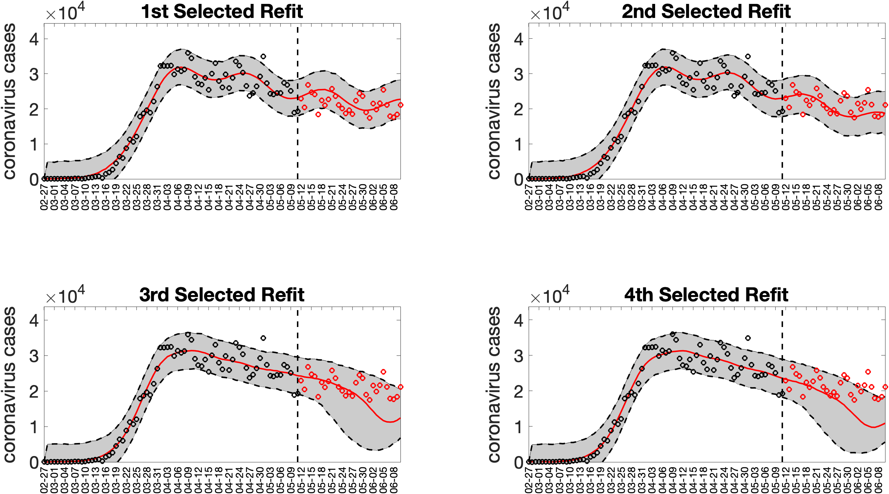
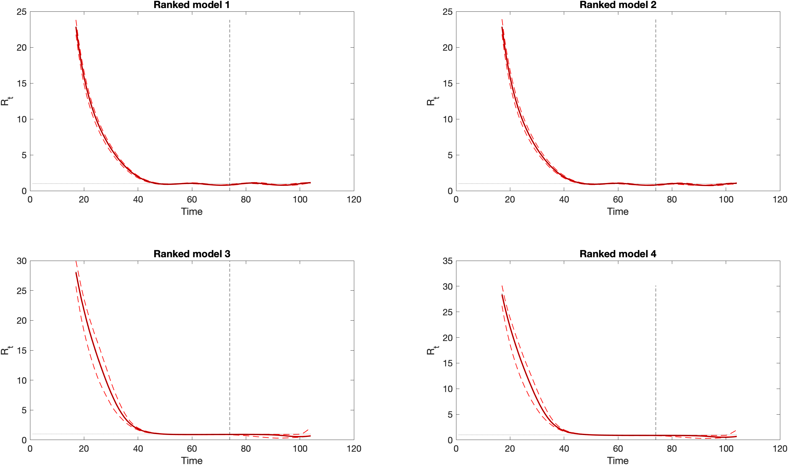

# SpatialWavePredict Toolbox

SpatialWavePredict is a MATLAB toolbox for fitting epidemic curves and generating short-term forecasts. It represents a reported incidence series as the sum of overlapping sub-epidemics. The timing and size of those components can produce several peaks or a prolonged plateau. Each component is inferred from the aggregate curve. When a dataset contains several regions, the toolbox fits each region separately.

The toolbox ranks fitted models by the corrected Akaike information criterion (AICc), generates individual and ensemble forecasts, and scores them against a flat baseline. It also reports practical parameter identifiability and estimates the effective reproduction number from the fitted incidence curve.

**Revision SW-9** adds the sub-epidemic cap, smoothing span and calibration-window length to result-table filenames. Readers updating scripts that import CSVs can find a worked filename below. [Output files](#output-files) · [Changes for existing users](#changes-for-existing-users) · [Source revision, November 22, 2026][revision]

[Quick start](#quick-start) · [Use your own data](#use-your-own-data) · [Model and settings](#model-and-settings) · [Evaluate forecasts](#evaluate-forecasts-across-dates) · [Parameter identifiability](#parameter-identifiability) · [Reproduction number](#effective-reproduction-number) · [Output files](#output-files) · [Citation](#citation)

## Quick start

The bundled example forecasts daily reported U.S. COVID-19 cases from **May 11, 2020**. It uses column 52 of the calibration file, then scores the forecast against the next 30 daily observations, **May 12 through June 10**.

### 1. Open the code directory in MATLAB

Download the repository using **Code → Download ZIP**, or clone it in a terminal.

```bash
git clone https://github.com/gchowell/SpatialWavePredict-Toolbox.git
```

Start MATLAB in the repository root and run the following commands. Keep the code directory as the current folder throughout the analysis. The scripts read `input/` and write `output/` relative to this folder.

```matlab
cd('spatialWave_subepidemicFramework code')
addpath(pwd)
if ~isfolder('output'), mkdir('output'); end
which options -all
which plotForecast_SW_subepidemicFramework -all
```

The first result of each `which` command should be in the current folder. There is a second forecast script at the repository root, and other toolboxes such as SubEpiPredict also provide an `options.m`.

| MATLAB product | Used for |
| --- | --- |
| Optimization Toolbox | Constrained parameter estimation with `fmincon` |
| Global Optimization Toolbox | Searching from multiple initial guesses with `MultiStart` |
| Statistics and Machine Learning Toolbox | Sampling for the bootstrap and forecast distributions |
| Parallel Computing Toolbox (optional) | Parallel candidate fits and bootstrap refits |

The shipped settings request a parallel pool. For a serial run, edit the existing [options_fit_settings_sw.m][overrides] and set `U.useParallel = false;`. The full fitting workflow requires MATLAB. To check the installation before running a full fit, run the self-check from the code directory. It checks the simulator, scoring and diagnostics and fits a small example. The full test suite is available via `runtests('tests')`.

```matlab
addpath(fullfile(pwd,'tests'))
spatialWaveSelfCheck();
```

### 2. Fit, inspect and forecast

The active configuration already points to the U.S. example. Run the following commands in order. The first command performs the model search and bootstrap. The remaining commands read the saved fit.

```matlab
area = 52;
origin = '05-11-2020';
horizon = 30;
weightType = 1;    % Akaike weights

Run_SW_subepidemicFramework(area, origin);
plotRankings_SW_subepidemicFramework(area, origin);
plotFit_SW_subepidemicFramework(area, origin);
[~, ~, ~, scores] = plotForecast_SW_subepidemicFramework(area, origin, horizon, weightType);
```

**What this run fits.** The shipped [options.m][options] uses a seven-day moving average, least squares with normal errors, 20 search start points and 300 bootstrap realizations per selected model. Its calibration window is capped at 90 observations. The example snapshot contains 75 daily observations, starting February 27, so all 75 enter calibration. The search allows up to **six** sub-epidemics, considers **both** exponential and power-law size decline, and selects up to four models for refitting. Run the fit even if `output/` contains bundled examples. The current plotting workflow needs the final ranking and its matching rank files.


*Fit diagnostics for the top-ranked model.* The upper panels show the bootstrap distributions of the growth coefficient ($r$), growth exponent ($p$), initial carrying capacity ($K$) and decline parameter ($q$). Below, the colored component curves show how successive sub-epidemics overlap. The residuals fluctuate more widely late in the calibration period.

### 3. Read the forecast

The forecast plot shows predicted incidence, its 95% prediction interval and the later observations. To compare models over the **full 30 days**, display the rows for the requested horizon.

```matlab
names = {'Model','Horizon','MAE','MSE','Coverage95Pct','WIS','RelativeWIS'};
disp(array2table(scores(scores(:,2) == horizon,:), 'VariableNames', names))
```

Model `0` is the flat baseline, model `1` is the best AICc-ranked refit, and model `102` is the ensemble of the first two ranks. A relative weighted interval score (WIS) below 1 means the model beat the baseline over those 30 observations. MAE and MSE are the mean absolute and mean squared errors.

**Check your dates and column selection.** The final seven daily increments in the May 11 snapshot total 166,615 cases in column 52. The flat baseline therefore predicts **23,802.14 cases per day**. Against the 30 observations from May 12 through June 10 in the verification file, its MAE is **2,956.69 cases per day**. These two values can be checked directly from the data, independently of the optimizer and bootstrap. To see *when* a ranked forecast missed, compare `data`, `median`, `LB` and `UB` after May 11 in its [dated trajectory file](#output-files).



*How to read the panels.* Each panel shows one ranked model. Black circles are calibration observations. To the right of the vertical line, red circles show the subsequent observations and the gray band is the 95% prediction interval. During this example, the fourth-ranked model projected a steeper decline than the first. The forecast function shows ensemble predictions separately in MATLAB figure 500. [More example figures](#example-figures)

For a smaller model search on the same data, set `npatches_fixed = 3;` and `typedecline2 = [1];` in `options.m` before fitting. SW-9 gives the resulting tables a different filename from the six-component run.

<a id="input-data"></a>

## Use your own data

1. **Prepare one numeric text matrix.** Put a whitespace-delimited `.txt` file in `input/`, with one observation interval per row and one region or group per column. The loader expects numeric observations only. Keep dates, column labels and other metadata separately. Set `outbreakx` to the one-based index of the column to fit.
2. **Specify the time axis in `options.m`.** Set `datevecfirst1` to the date of row 1 and `DT` to `1` (daily), `7` (weekly) or `365` (yearly). Set `caddate1` to the date of the last calibration observation, using `mm-dd-yyyy`. The runner reads the entire file, so its **last row** must actually correspond to that date.
3. **Match the filename to the data type.** Set `caddisease`, `datatype` and `cadregion` to the strings used in the filename. Set `cumulative1` using the table below.
4. **Set the forecast horizon and verification data.** In [options_forecast.m][forecast-options], `forecastingperiod` counts observation intervals. For example, `4` means four weeks for weekly observations. For retrospective scoring, set `getperformance = 1` and point `datevecend1` in `options.m` to a later snapshot covering the entire horizon, with the same first date, frequency and column order. For a forecast without later observations, use `getperformance = 0` and the default Akaike weights.

| Input | Setting | Filename pattern |
| --- | --- | --- |
| New counts per interval | `cumulative1 = 0` | `<frequency>-<disease>-<datatype>-<region>-<mm-dd-yyyy>.txt` |
| Cumulative counts | `cumulative1 = 1` | `cumulative-<frequency>-<disease>-<datatype>-<region>-<mm-dd-yyyy>.txt` |

For the quick start, the two files are `cumulative-daily-coronavirus-cases-USA-05-11-2020.txt` (calibration) and `cumulative-daily-coronavirus-cases-USA-05-31-2021.txt` (verification). To adapt the workflow, edit the assignments in the active configuration functions. Each entry point reads those files again.

**Check the incidence that will be fitted.** Cumulative input `y` becomes `[y(1); diff(y)]`. A cumulative series that starts mid-outbreak can therefore contribute its entire pre-existing total as the first observation. Supply interval counts when that baseline can be separated. Reconcile downward reporting corrections and missing intervals before fitting. Count likelihoods describe nonnegative integer counts. The raw-count path rejects negative values and warns about fractional observations.

The runner requires at least one positive observation in the selected window. It retains the most recent `calibrationperiod1` observations and drops leading zeros in that window. It skips series with fewer than eight remaining observations. A candidate also needs more than $k+1$ observations for a finite AICc, where $k$ is its parameter count.

<a id="configuration"></a>

## Model and settings

With the generalized-logistic growth function (`flag1 = 1`), the cumulative size $C_j$ of active sub-epidemic $j$ follows

```math
\frac{dC_j}{dt}=r C_j^p\left(1-\frac{C_j}{K_j}\right).
```

The components share the growth coefficient $r$ and early-growth exponent $p$. The first component has carrying capacity $K_0$. Later capacities follow $K_j=K_0\exp[-q(j-1)]$ (exponential) or $K_j=K_0 j^{-q}$ (power law). At $q=0$ their capacities are equal. With threshold-triggered onset, the next component begins growing when its predecessor reaches the fitted onset threshold. A model can therefore produce a higher aggregate peak when components overlap even if each successive component has a smaller capacity. [Model equations][ode] · [Simulation and activation][simulator]

| Active file | Settings to change |
| --- | --- |
| [options.m][options] | Dataset and dates, smoothing, calibration window, growth model, decline family, estimation method, search start points, bootstrap size and number of ranked models |
| [options_forecast.m][forecast-options] | Horizon, ensemble weights, scoring and retention of intermediate forecast files |
| [options_fit_settings_sw.m][overrides] | Overrides for fitting and reporting. This file ships with `useParallel = true`, `weekdayAdjustment = false` and `modelErrorIntervals = true`. Inspect the effective settings with `spatialWaveFitSettings()`. |
| [options_Rt_sw.m][rt-options] | Generation-interval distribution, mean, variance and minimum coverage for the reproduction-number calculation |

**Candidate models.** Choose one growth function with `flag1` — `0` generalized growth, `1` generalized logistic, `2` generalized Richards, `3` logistic, `4` Richards or `5` Gompertz. Generalized growth has no carrying-capacity term. Set `onset_fixed = 0` for threshold-triggered onset or `1` for simultaneous onset. Use `typedecline2 = [1]`, `[2]` or `[1 2]` for exponential decline, power-law decline or both. The number of components active during calibration can be smaller than `npatches_fixed`. Eligible wave models can activate up to ten additional components in the forecast.

**Fitting and observation error.** `method1` selects the objective. `dist1` controls how observation-level variation is simulated. The toolbox resolves permitted combinations before fitting. [Error-structure rules][errors]

| `method1` | Objective | Effective `dist1` |
| --- | --- | --- |
| `0` or `2` | Least squares or Pearson chi-squared, respectively | Choose `0` normal, `1` Poisson or `2` negative binomial with an empirical variance-to-mean factor |
| `1` | Poisson likelihood | `1` |
| `3`, `4` or `5` | Negative-binomial likelihood with variance $\mu+\alpha\mu$, $\mu+\alpha\mu^2$ or $\mu+\alpha\mu^d$, respectively | Matches `method1` |
| `6` | Absolute deviations with Laplace errors | `6` |

With the shipped settings, Poisson and negative-binomial objectives use raw counts. Least squares uses a moving average when `smoothfactor1 > 1`. Smoothing reduces day-to-day residual variation and can produce narrow prediction intervals when evaluated against reported counts. For an unsmoothed fit, set `smoothfactor1 = 1`. Optional weekday adjustment for daily data estimates reporting factors from the calibration window. It needs at least 21 observations and sufficient data for each weekday. Keep smoothing off when using it, and compare its performance on held-out observations. The AICc calculation omits the weekday factors from its parameter count. [Fitted-series rules][fit-series] · [Advanced settings][settings]

**Rankings and ensembles.** The runner screens candidates, refits the selected models, then recomputes AICc for each accepted refit. The resulting rank 1 has the lowest AICc among those refits. Ensemble($k$) combines the first $k$ ranks. The shipped `weight_type1 = 1` uses normalized Akaike weights proportional to $\exp[-(\mathrm{AICc}_i-\mathrm{AICc}_{\min})/2]$. Other choices are `-1` (equal weights), `0` (legacy inverse AICc, requiring positive scores) and `2` (inverse calibration WIS). The last choice requires scoring to be enabled and uses in-sample scores. The ensemble plotting routine has three panels for ensemble sizes two through four. Evaluate forecast skill at later dates. [Weight calculation][weights]

<a id="evaluating-forecasts-over-many-dates"></a>

## Evaluate forecasts across dates

A rolling-origin evaluation repeats the fit and forecast at several historical cutoffs. For example, these three bundled snapshots give forecasts two weeks apart, each scored against the following 30 days. In `options_forecast.m`, set `getperformance = 1`.

```matlab
origins = {'04-27-2020','05-11-2020','05-25-2020'};
R = spatialWaveRollingForecast(origins, 30, 52, 1, 'quiet', true);
disp(R.status)      % Column labels in R.statusColumns
disp(R.summary)     % Column labels in R.summaryColumns
```

The baseline predicts the recent mean at every horizon (last seven observations for daily data, last observation for weekly or yearly data). Its intervals use historical errors of the same rule within the calibration series. Scores **over $h$** average the first $h$ forecast steps. The rolling summary also reports WIS and coverage **at step $h$** across origins. For example, a forecast may be accurate in week one and miss a turn in week two. The score over 14 days will average those periods together.

| Rolling WIS comparison | Interpretation |
| --- | --- |
| Ratio of means | Mean model WIS divided by mean baseline WIS on paired origins. Below 1 favors the model. |
| Typical ratio | Geometric mean of the origin-specific ratios for positive scores. Below 1 favors the model. |
| Share better | Fraction of paired origins won by the model, counting ties as one-half. Above 0.5 favors the model. |

Inspect `R.byDate` for differences across origins and `R.status` and `R.notes` for skipped dates or warnings. Overlapping horizons share target observations, so the three example dates illustrate the workflow and give limited evidence about comparative skill.

**Data vintages and saved fits.** The rolling driver uses an existing, correctly sized snapshot for each origin. If one is missing, it writes the prefix of the later verification file to `input/`. Such a reconstruction can include revisions made after the origin. Use archived snapshots to evaluate forecasts with counts available at the time. The driver checks fit settings and the fitting revision when reusing a result. After correcting data, update the affected origin files and pass `'refit', true` to rebuild those fits. [Rolling forecast driver][rolling]

**Intervals adjusted for earlier forecast errors.** The shipped override enables `modelErrorIntervals` for rolling evaluation. Alongside the original scores, `R.adjustedScores` and `R.adjustedSummary` show the effect of widening model intervals using past forecast errors whose target dates have already passed by the new origin. The adjustment preserves the median. With fewer than ten eligible errors at the default settings, it reports a scale factor of one. Compare coverage and WIS together because an interval can gain coverage simply by becoming wider. [Interval adjustment][model-error]

## Parameter identifiability

Each ranked fit reports how precisely its continuous parameters are estimated within the chosen model and search bounds. The forecast function exports one row per parameter and rank in `identifiability-*.csv`. The bootstrap holds the selected onset threshold and decline family fixed across refits.

| Read this field | What it tells you |
| --- | --- |
| `CI_LB`, `CI_UB`, `PII` | The 95% bootstrap interval and its log-width, $\log_{10}(\mathrm{CI}_{UB}/\mathrm{CI}_{LB})$. A PII of 1 means a tenfold span. The log-width is defined for a positive lower interval limit. |
| `PII_rangeFrac`, `PII_ratio` | How much of the allowed search range the interval occupies. The default headline scale uses log-width for a positive lower search bound and range fraction for a zero lower bound. |
| `fracLB`, `fracUB`, `MCSE_PII` | Fractions of refits near each search bound and Monte Carlo standard error of the log-width. |
| `verdict`, `most_correlated_with`, `rank_correlation` | The practical-identifiability classification and the strongest pairwise association across refits. The printed report flags trade-offs at absolute rank correlation of at least 0.9 by default. |

For example, a strong $r$–$p$ trade-off means that different growth coefficients and exponents produced similar fitted curves. Read each interval alongside the correlations and the number of unresolved bootstrap refits. The code can retain a valid optimizer endpoint from an unresolved refit, marked in `bootstrapDiagnostics.usedFallback`. These diagnostics describe practical identifiability under the selected data, bounds and bootstrap assumptions. Structural identifiability requires a separate analysis. [Identifiability calculations][pii]

## Effective reproduction number

Set the generation interval in [options_Rt_sw.m][rt-options] before interpreting $R_t$. Choose gamma, exponential or fixed and express the mean in observation intervals (days for daily data, weeks for weekly data). The gamma option takes a **variance** in squared observation intervals. The supplied values are illustrative.

```matlab
edit options_Rt_sw
summary = plotReproductionNumber_SW(52, '05-11-2020', 30);
```

The function uses the renewal equation to estimate $R_t$ from the model incidence curve, excluding reporting-day effects. It reads the saved rank files and repeats the calculation over the bootstrap refits. Early estimates are blank until the available incidence history covers the specified fraction of the generation-interval distribution (99% by default). The 95% interval reflects fitted-parameter uncertainty conditional on the selected model and generation interval. The magnitude and timing of a crossing of 1 can depend on the generation interval, especially near a turning point. [Reproduction-number calculation][rt]



*Effective reproduction number for the four ranked models.* The vertical dashed line marks the last calibration observation. To its right, each curve shows the model’s projected $R_t$. The solid red line is the bootstrap median and the dashed red lines give the 95% interval. The horizontal dotted line marks $R_t=1$.

<a id="outputs"></a>

## Output files

The toolbox writes to `output/`. SW-9 result tables and rolling logs now include the number of sub-epidemics allowed during fitting, the smoothing span and the requested calibration-window length. For the shipped example the tag is `npatchesfixed-6-smoothing-7-calibrationperiod-90-`. The `90` records the configured window even though only 75 observations were available. In the rest of the filename, `typedecline-3` denotes a search over both decline families because the writer records the sum of `[1 2]`. [Filename construction][output-tag]

For example, after the quick start the first-ranked trajectory can be read as follows.

```matlab
tag = spatialWaveOutputTag(6, 7, 90);
suffix = 'onsetfixed-0-typedecline-3-flag1-1-method-0-dist-0-horizon-30-daily-coronavirus-cases-USA-area-52-05-11-2020.csv';
trajectory = readtable(fullfile('output', ['ranked(1)-' tag suffix]));
disp(trajectory(76:78, {'year','month','day','data','median','LB','UB'}))
```

Rows 76–78 are the first three forecast days in this example. To check another configuration, call `options();` followed by `spatialWaveOutputTag()` to see its tag. Bootstrap size, the random seed and the input-data version can still change results under the same filename. Archive the complete output directory when comparing runs that differ on those settings.

| To find… | Open in `output/` |
| --- | --- |
| Final ranking and matching fit files for plotting | `FinalFit-original-*.mat` and `modifiedLogisticPatch-original-*-rank-*.mat`. The `ABC-original-*.mat` file contains the earlier candidate search. |
| AICc, parameters and calibration performance | `AICc-topRanked-*.csv`, `parameters-topRanked-*.csv`, `performance-calibration-*.csv` |
| Dated forecasts and 95% prediction intervals | `ranked(k)-*.csv` and `Ensemble(k)-*.csv` for the chosen rank or ensemble size. These include calibration and forecast rows. With scoring off, ensemble trajectory CSVs omit the year column. |
| Predictive distributions and doubling times | `quantile-*.csv`, `doublingTimes-*.csv`. Quantile CSVs contain 23 predictive quantiles from 0.01 to 0.99. Calibration rows come first. In the quick start, forecast rows are 76–105. `Forecast-*.mat` retains intermediate draws when `deletetempfiles = 0`. |
| Scores against later observations | `performance-forecasting-byHorizon-*.csv` for baseline, ranked models and ensembles. The top-ranked and ensemble performance CSVs summarize the full horizon. |
| Performance across origins | `rolling-forecast-scores-*.csv`, `rolling-forecast-summary-*.csv`, and `rolling-forecast-scores-modelerror-*.csv` for adjusted scores when enabled. The rolling driver returns the actual paths as `R.scoresFile` and `R.summaryFile` for scored runs. With `'quiet', true`, see `rolling-log-*.txt` for each run. |
| Parameter uncertainty and effective reproduction number | `identifiability-*.csv`, `Rt-ranked(k)-*.csv` and `Rt-summary-*.csv` |

### Changes for existing users

- **CSV imports.** Earlier output tables keep their old names. A broad pattern such as `ranked(1)-*.csv` can now match multiple settings and older files for the same origin. Use the new tag plus the dataset, origin and horizon when selecting a table. The existing MAT-file naming scheme and the fitting revision (`SW-2`) carry forward. A compatible saved fit can be used to regenerate tables by rerunning the corresponding plot or forecast command. [Output tag][output-tag] · [Fit revision][fit-revision]
- **Option presets.** In this checkout the historical preset scripts are in the code directory. Running `cleanup_leftover_files()` there previews the files the utility would move. To apply the displayed moves, run `cleanup_leftover_files(true)`, followed by `rehash; clear functions`. The utility moves preset files to `option_presets/` and designated obsolete files and editor autosaves to `removed_files/`. This housekeeping step is optional. To use a historical preset, copy the relevant assignments into the active options file and keep its function signature. In particular, `options_mpox.m`, `options_mpx2.m` and `optionsx.m` have an older output layout. [Cleanup utility][cleanup] · [Preset guide][presets]
- **Quantile helper.** The function declaration in `computeQuantiles.m` now matches its filename. For scripts that already have observation-scale draws, `[Qcal,Qforecast,levels] = computeQuantiles(data1,curvesforecasts2,horizon)` returns separate calibration and forecast matrices plus their quantile levels. Rows of the draws matrix run in time order, with one column per simulated trajectory. [Quantile helper][quantiles]

### Example figures

[Ranked fits](docs/images/rankings.png) · [Relative likelihood](docs/images/relativelikelihood.png) · [Fit and residuals](docs/images/model_fit.png) · [Parameters](docs/images/parameters.png) · [Sub-epidemic projections](docs/images/forecasts.png) · [Effective reproduction number](docs/images/reproductionnumber.png) · [Calibration performance](docs/images/performance_calibration.png) · [Ranked forecast performance](docs/images/performance_forecast.png) · [Ensemble performance](docs/images/performance_ensemble.png)

After fitting, the following command exports figures from that run to a separate directory. The fifth argument sets the destination. Omitting it writes to `../docs/images/`.

```matlab
make_readme_figures(52, '05-11-2020', 30, 1, fullfile('output','figures'));
```

<a id="reproducibility-and-troubleshooting"></a>

## Troubleshooting and reproducibility

| Symptom | What to check |
| --- | --- |
| Input file missing or unexpected options | Run `pwd`, `which options -all` and `which options_forecast -all`. Check filename spelling, cumulative prefix, column index and four-digit year. |
| `SpatialWave:FinalFitResultsRequired`, rank mismatch or missing $R_t$ fit | Run the fit for the same area, origin and settings. Keep its final ranking with the rank files produced in that run. |
| `SpatialWave:PatchLimitBinding` | Extra components start as soon as the forecast permits them in many bootstrap curves. Compare with a fit allowing a larger `npatches_fixed`. |
| `SpatialWave:SameCurveModels` | Two candidates produce the same calibration curve. Their forecasts can diverge when a previously unreached threshold is crossed. |
| `SpatialWave:BootstrapAtBound` or `SpatialWave:NotIdentified` | Inspect search bounds, interval widths, boundary-hit fractions and parameter trade-offs before interpreting an estimate. |
| Forecast scoring stops or an origin is skipped | Check that the later file has observations through the last target date, and compare its start date, sampling interval and columns with the calibration file. For rolling runs inspect `R.notes`. |

For a reproducible analysis, retain the Git commit (`git rev-parse HEAD`), MATLAB and toolbox versions (`ver`), active option files, exact input snapshots, and the final ranking with its rank files. The fit and forecast drivers apply `rngSeed` internally (default `1`). To use a caller-controlled random stream, set `U.rngSeed = [];` in the advanced settings. Include the command, settings and complete error text when opening a [GitHub issue][issues].

## Citation

Cite the toolbox tutorial and report the code revision used. The tutorial and video cover the original workflow. The commands above correspond to the current repository layout.

- **Toolbox tutorial.** Chowell G, Tariq A, Dahal S, Bleichrodt A, Luo R, Hyman JM. SpatialWavePredict: a tutorial-based primer and toolbox for forecasting growth trajectories using the ensemble spatial wave sub-epidemic modeling framework. *BMC Medical Research Methodology*. 2024, 24, 131. [Article][tutorial] · [Video walkthrough][video]
- **Original framework.** Chowell G, Tariq A, Hyman JM. A novel sub-epidemic modeling framework for short-term forecasting epidemic waves. *BMC Medicine*. 2019, 17, 164. [Article][framework]
- **Forecasting application.** Chowell G, Rothenberg R, Roosa K, Tariq A, Hyman JM, Luo R. Sub-epidemic Model Forecasts During the First Wave of the COVID-19 Pandemic in the USA and European Hotspots. In *Mathematics of Public Health*. 2022, pp. 85–137. [Chapter][application]

## License

SpatialWavePredict is distributed under the GNU General Public License, version 3. [License terms](LICENSE)

[revision]: https://github.com/gchowell/SpatialWavePredict-Toolbox/tree/d17f624944ead9fb41406ac907c1d1e30750ec37
[output-tag]: spatialWave_subepidemicFramework%20code/spatialWaveOutputTag.m
[cleanup]: spatialWave_subepidemicFramework%20code/cleanup_leftover_files.m
[presets]: spatialWave_subepidemicFramework%20code/option_presets/README.md
[quantiles]: spatialWave_subepidemicFramework%20code/computeQuantiles.m
[fit-revision]: spatialWave_subepidemicFramework%20code/spatialWaveFitRevision.m
[tutorial]: https://doi.org/10.1186/s12874-024-02241-2
[framework]: https://doi.org/10.1186/s12916-019-1406-6
[application]: https://doi.org/10.1007/978-3-030-85053-1_5
[video]: https://www.youtube.com/watch?v=qxuF_tTzcR8
[issues]: https://github.com/gchowell/SpatialWavePredict-Toolbox/issues
[options]: spatialWave_subepidemicFramework%20code/options.m
[forecast-options]: spatialWave_subepidemicFramework%20code/options_forecast.m
[overrides]: spatialWave_subepidemicFramework%20code/options_fit_settings_sw.m
[rt-options]: spatialWave_subepidemicFramework%20code/options_Rt_sw.m
[errors]: spatialWave_subepidemicFramework%20code/spatialWaveErrorStructure.m
[fit-series]: spatialWave_subepidemicFramework%20code/spatialWaveFitSeries.m
[weights]: spatialWave_subepidemicFramework%20code/getSpatialWaveAICcWeights.m
[ode]: spatialWave_subepidemicFramework%20code/modifiedLogisticGrowthPatch.m
[simulator]: spatialWave_subepidemicFramework%20code/simulateSpatialWave.m
[settings]: spatialWave_subepidemicFramework%20code/spatialWaveFitSettings.m
[rolling]: spatialWave_subepidemicFramework%20code/spatialWaveRollingForecast.m
[model-error]: spatialWave_subepidemicFramework%20code/spatialWaveModelErrorIntervals.m
[pii]: spatialWave_subepidemicFramework%20code/spatialWaveIdentifiability.m
[rt]: spatialWave_subepidemicFramework%20code/spatialWaveReproductionNumber.m
